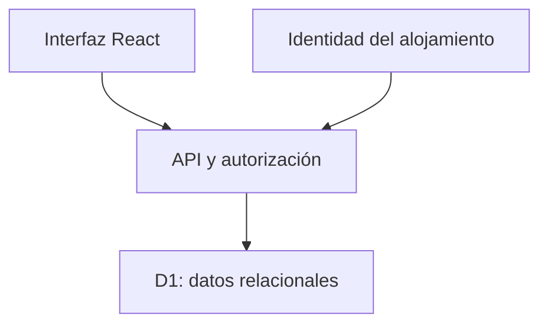

# Arquitectura de Ronda

Estado: piloto privado. Fecha: 2026-11-04. Arquitectura: monolito modular, React + TypeScript, endpoints HTTP, datos relacionales.

## Implementado

| Capa | Elección | Responsabilidad |
|---|---|---|
| UI | React 19, TypeScript, CSS, Lucide | Descubrimiento, preferencias y agenda |
| Runtime | Vinext beta, APIs de Next App Router, Workers | Renderizado y handlers |
| Identidad | Identidad del alojamiento | ID estable por sitio, requerido para escrituras |
| Persistencia | D1 / SQLite, Drizzle | Encuentros, reservas, perfiles, favoritos y reportes |
| Activos | Archivos estáticos locales | Fotografías ilustrativas; sin uploads de usuarios |
| Entrega | Commit de fuente + build versionado | Despliegue privado y recuperación de versión de código |

Vinext beta es una elección de runtime para este piloto. La compatibilidad de APIs no equivale a paridad total con Next.js; cualquier cambio de plataforma necesita pruebas. React permite conservar el trabajo visual en esa transición.

## Contratos HTTP

| Método y ruta | Acceso | Operación |
|---|---|---|
| GET /api/rondas | Visitante dentro del acceso del sitio | Hasta 200 encuentros reales más ejemplos; incluye cancelados de tus reservas |
| POST /api/rondas | Cuenta | Valida y crea; máximo 5 creaciones por día |
| DELETE /api/rondas/:id | Propietario | Cancela sin ocultar el estado a participantes |
| GET /api/me | Cuenta o exploración anónima | Devuelve solo tus datos de agenda, perfil y guardados |
| POST /api/bookings | Cuenta | Inscribe o retira; cupos reales en una sentencia atómica |
| POST /api/favorites | Cuenta | Añade o elimina un guardado idempotente |
| POST /api/profile | Cuenta | Guarda nombre público e intereses |
| DELETE /api/profile | Cuenta | Borra los datos de aplicación y dependencias en transacción |
| POST /api/reports | Cuenta | Registra motivo; máximo 5 reportes al día |

Las escrituras requieren origen igual al de la solicitud. Identidad y propiedad se obtienen en servidor. No se confía en IDs de usuario enviados por el navegador. Los emails de autenticación no se publican.

## Datos

`rondas` (id, owner_id, host_name, título, descripción, resultado, categoría, modalidad, ciudad, lugar, fecha UTC, duración, aforo, estado, creación). Índices de descubrimiento y propietario.

`bookings` y `favorites`: clave compuesta (user_id, ronda_id). Las reservas tienen fecha de creación; índice por ronda. `profiles`: clave por usuario, nombre público, intereses y habilidad. `reports`: ID, usuario, ronda, motivo y fecha.

Los IDs de ejemplos viven en código. Por esa razón el piloto no declara FK para ronda_id en reservas/favoritos/reportes. Los endpoints verifican que el encuentro exista y el borrado elimina dependencias en transacción. Para producción, mover los ejemplos fuera de las tablas reales o registrarlos con una bandera demo y establecer FK. Evitar mezclar métricas de ensayo con métricas de actividad real.

## Backend definitivo: decisión pendiente

| Opción | Ajuste al producto | Trabajo adicional |
|---|---|---|
| Workers + D1 actual | Piloto pequeño y costo operativo sencillo | Acceso general, notificaciones, moderación; medir capacidad por base |
| Next.js convencional + PostgreSQL administrado, p. ej. Supabase | Relaciones, políticas por fila, consultas geográficas futuras, acceso con email | Sustituir adaptadores y consultas D1, migrar esquema/datos, configurar auth y probar permisos |
| API Node/Nest + PostgreSQL | Integraciones e independencia entre web y futura app | Desplegar, operar y observar un servicio adicional |

Recomendación: conservar el piloto mientras validamos demanda. Para un servicio comunitario abierto con agenda, permisos y ubicación, evaluar Next.js + PostgreSQL administrado como opción principal. Un backend Node separado puede incorporarse cuando existan necesidades concretas de integraciones o consumidores adicionales.

D1 tiene un límite documentado de 10 GB por base en Workers Paid y procesa consultas secuencialmente por base. La capacidad depende de la duración real de las consultas; no se afirma que esta implementación soporte un volumen determinado de usuarios. Fuente: https://developers.cloudflare.com/d1/platform/limits/

## Camino de crecimiento

1. Antes de 200 convocatorias: búsqueda y filtros en servidor, cursor `(starts_at,id)`, índices por consulta y control explícito de resultados truncados.
2. Antes de acceso abierto: roles operador/anfitrión/participante, revisión de reportes, bloqueo de abuso, consentimiento, coordinación privada y exportación de datos personales.
3. Al añadir recordatorios: outbox transaccional, cola, reintentos con clave idempotente y consentimiento de notificaciones.
4. Al admitir fotos: subida firmada, límite de tamaño/formato, tratamiento de metadatos y moderación.
5. Operación: métricas p95 por endpoint, tasa de error, consultas lentas, gasto diario, backups y prueba de restauración. Objetivos iniciales propuestos: disponibilidad 99.5%, API p95 <700 ms bajo carga definida, alerta si errores superan 2% durante 5 minutos. No son resultados medidos.
6. Medir carga sobre staging con un dataset representativo; ajustar base y caché según cuello observado. Los datos personalizados no deben entrar en una caché pública.

## Referencias técnicas

- https://nextjs.org/docs/app/getting-started/route-handlers
- https://github.com/cloudflare/vinext
- https://developers.cloudflare.com/d1/platform/limits/
- https://supabase.com/docs/guides/database/postgres/row-level-security
- https://supabase.com/pricing
- https://vercel.com/pricing
